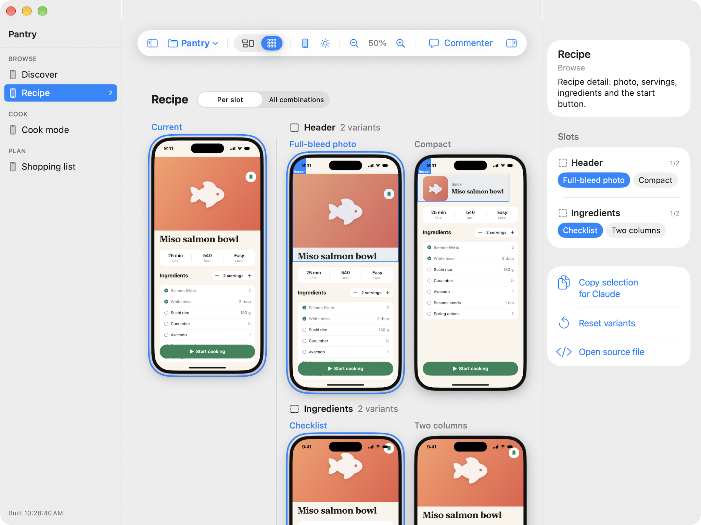

# UI Studio

A small Mac app for laying out iOS screens written in SwiftUI. Every screen is a real SwiftUI view rendered inside a phone frame on a canvas, so what you see is what ships.

I built it to design screens together with Claude Code: I describe a screen, Claude writes the SwiftUI, and I compare the options side by side in the app.



## Features

- **Canvas** with every screen of a project, grouped by flow, at the size of a real iPhone (light and dark mode).
- **Slots and variants.** Wrap any part of a screen in a `Slot` with a few `Variant`s, then switch between them from the inspector, or open the Variants view to see each option next to the others.
- **Comments.** Pin a comment on any element of a screen. Comments are saved as JSON with an annotated screenshot, so an agent can read and apply them.
- **Design kit** (`DesignKit/`): spacing, radius, colors, fonts and a few base components shared by every screen. It can be dropped into a real app as is.
- **Mac windows.** A screen can also be shown as a macOS window instead of a phone.
- **Several projects** in the same app, each with its own screens. `Screens/PantryDemo/` is a small recipe app you can use as an example.

## Requirements

- macOS with Xcode 26 or later
- The app runs as Mac Catalyst; screens target iOS 17+

## Getting started

```bash
git clone https://github.com/LeoBrunet/UIStudio.git
cd UIStudio
./studio.sh
```

`studio.sh` builds the app, copies it to `/Applications/UI Studio.app` and launches it. Run it again after editing a screen; the canvas keeps its selection, zoom and chosen variants.

```bash
./studio.sh build          # build without relaunching
STUDIO_INSTALL=0 ./studio.sh   # run from .build instead of /Applications
```

## Adding a screen

Create a file under `Screens/`:

```swift
import SwiftUI

struct LoginScreen: StudioScreen {
    static let info = ScreenInfo("Login", flow: "Onboarding", notes: "Email + password, with Apple sign-in.")

    var body: some View {
        VStack(spacing: DS.Spacing.l) {
            Slot("Header") {
                Variant("Minimal") { Text("Welcome back").font(.dsTitle) }
                Variant("Big title") { Text("Good to see you again.").font(.largeTitle.bold()) }
            }
            // ...
        }
    }
}
```

It shows up on the next build: `Screens/ScreenRegistry.swift` is generated by `studio.sh`, don't edit it by hand.

For a macOS window instead of a phone:

```swift
static let info = ScreenInfo("Toolbar", flow: "Interface", frame: .mac(width: 1200, height: 760))
```

## Project layout

```
Studio/      the canvas app (slot system, store, sidebar, inspector)
Screens/     one file per screen, grouped by flow
DesignKit/   tokens and shared components
Export/      clean copies of finished screens, without slots
studio.sh    build + relaunch
```

## Working with Claude Code

`CLAUDE.md` describes the conventions for an agent: how to add screens and variants, how to read pinned comments, and how several sessions can work on different screens at the same time (builds are queued, and `feedback-watch.sh` filters comments by screen).

## Notes

- Dynamic Type isn't previewable: Mac Catalyst keeps text sizes fixed. Check them in the iOS Simulator.
- Sheets presented from a screen cover the whole window, not just the phone.
